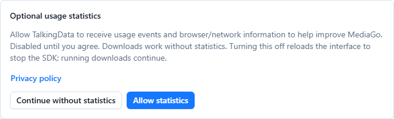

# Privacy policy

Updated: 24 October 2026. Contact: [MediaGo maintainer](mailto:84996057@qq.com).

This describes MediaGo desktop and the Web interface, including self-hosted Docker deployments. The statistics controls below apply to versions that include them; older releases may behave differently. Review this policy when upgrading. Self-hosted operators control their own server data and any analytics configuration.

## Downloads, browsing and local data

MediaGo processes the URLs, request headers and optional authentication information you provide to download or inspect media. These requests go to the websites, media servers, proxies and tools involved in the operation, including private-network servers you choose. Those recipients can see network information such as your IP address. Turning statistics off does not stop a download, update check or web page that you request.

Downloaded files, task history, favorites, settings, browser storage and diagnostic logs are stored on your computer or your configured server. Logs can contain resource URLs, paths or error details. Review and redact them before sharing. MediaGo does not automatically send these records to the maintainer through its application-event statistics interface. Websites opened in the embedded browser have their own cookies and privacy practices.

## Optional TalkingData statistics

The application retains a TalkingData JavaScript/H5 integration, provided by Beijing Tendcloud Technology Co., Ltd. (北京腾云天下科技有限公司). A build must have a configured analytics application ID **and you must agree** before MediaGo loads the SDK. A missing preference, a read failure or an unconfigured build does not enable statistics.

When enabled, MediaGo sends names of feature-use events, such as opening pages, starting/stopping downloads, conversion actions and checking for updates. Its event wrapper does not attach machine IDs, task IDs, resource URLs, filenames, passwords, API keys or arbitrary event parameters. The SDK request includes the application ID and version.

The third-party script executes in the interface and can process browser/network information, such as IP address, browser/OS characteristics, language, page context, session/interaction times, cookies or browser storage identifiers. Do not treat this as anonymous solely because MediaGo omits its own machine ID. See the [TalkingData SDK privacy policy](https://www.talkingdata.com/sdkprivacy.jsp?languagetype=en_us) and [TalkingData privacy policy](https://www.talkingdata.com/privacy.jsp?languagetype=en_us). A mobile SDK permission list is not a claim that this desktop/Web integration reads mobile identifiers.

Statistics help the maintainer understand feature use and improve the application. They are optional, and declining them does not reduce download functionality. MediaGo does not add your download contents to its feature-event payloads or use this wrapper to sell those contents.

## Your choice

- **Windows interactive installer:** the statistics checkbox is off on a fresh install and shows a saved choice for the current Windows account when available. Leaving it unchecked records refusal. Silent/automatic updates preserve preferences and do not create consent.
- **Portable packages, macOS/Linux and existing installations without a recorded choice:** an in-app notice lets you allow statistics or continue without them. No SDK is loaded while you have not chosen.
- **Settings → Basic settings → Share usage statistics:** change your choice at any time. Disabling reloads the interface to destroy the SDK's existing timers; Core downloads continue in the background. It does not undo requests already sent.
- **Web/Docker:** the choice belongs to the current browser/site storage, not to a shared server setting. Other browsers and desktop users choose separately. Clearing site storage removes the choice and returns statistics to off until you agree again.
- If saving fails, the interface reports the failure rather than claiming a new choice was saved. You can retry or close the application.

The preference is stored for the current desktop OS user in the `MediaGo/analytics-consent` file under the OS application-data directory; on Windows this is `%APPDATA%\MediaGo\analytics-consent`. The Web interface uses the `mediago.analytics-consent.v1` local-storage entry. These are preference values, not authentication credentials.

## Recipients, retention and deletion

Local records remain until you remove them through the application or remove the relevant application/server data. Removing a task may not delete an exported or downloaded file; manage those files separately. Disabling statistics keeps your refusal preference.

Enabled analytics is processed by TalkingData's service. Service-side retention and processing locations depend on the provider's policy and the applicable service-account settings; the client cannot determine or enforce a specific retention period or country. We do not promise a fixed deletion deadline or processing location that has not been verified. Revoking consent stops future SDK loading after the interface reloads; it does not automatically erase data already received by TalkingData or all browser storage created by a previous session.

For access, correction, deletion, withdrawal or questions about previously sent statistics, contact **84996057@qq.com**. Include the application version, approximate date and request type; do not send passwords, cookies, API keys or a full unredacted log. We will assess the request and coordinate with the service provider where necessary. For a self-hosted server, also contact its operator. You may exercise the rights available under the law applicable to you.

## Website and other services

The public documentation site is separate from the application's TalkingData choice. Its production configuration includes Baidu Analytics and Google Analytics; comments or links may connect to GitHub and other services you choose. Those services receive their own browser/network data and use their own policies. The in-app switch does not control a browser visiting the public site. See [Google's privacy policy](https://policies.google.com/privacy) and [Baidu's privacy policy](https://privacy.baidu.com/policy).

Updates to the purpose or scope of analytics will be reflected in the public policy. Security signing status is described separately in the [Code signing policy](./code-signing.md).
